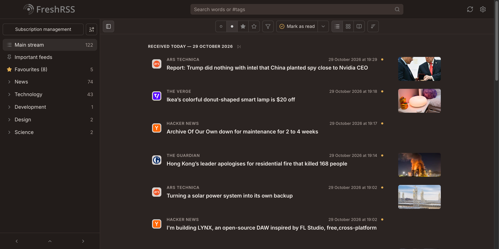

# Reed

A calm, warm theme for [FreshRSS](https://freshrss.org).

- Warm paper palette by day and warm brown by night, each with an amber accent
- Centred article column without row separators, large favicons and uppercase feed names
- Grouped settings pages with pill switches
- [Lucide](https://lucide.dev) icons throughout
- Bundled [Inter](https://rsms.me/inter/) for the interface and [Literata](https://github.com/googlefonts/literata) for articles, so text looks the same on every OS

Prefer a denser list? *Reed Compact* shows one article per line.

Reed follows the system’s light or dark appearance while **Settings → Display → Automatic dark mode** is set to **Auto** (the default).

## Known limitations

- Statistics chart colours are hard-coded by FreshRSS and aren’t themed.
- Icons in background-loaded panels are swapped through CSS `content: url()`, which may not work in Firefox.

## Fonts

The fonts are split by script so browsers only download Greek and Cyrillic when an article needs them.
The subsetting script lives in the [standalone repository](https://github.com/SiggeMcKvack/reed-theme).

## License

Lucide icons are [ISC licensed](LICENSE-lucide). Inter and Literata are OFL-1.1 licensed ([Inter](LICENSE-inter), [Literata](LICENSE-literata)).
